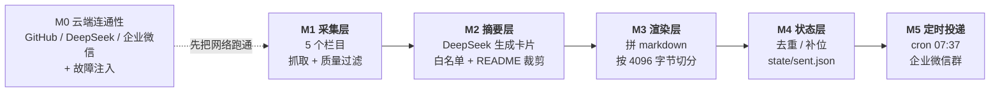
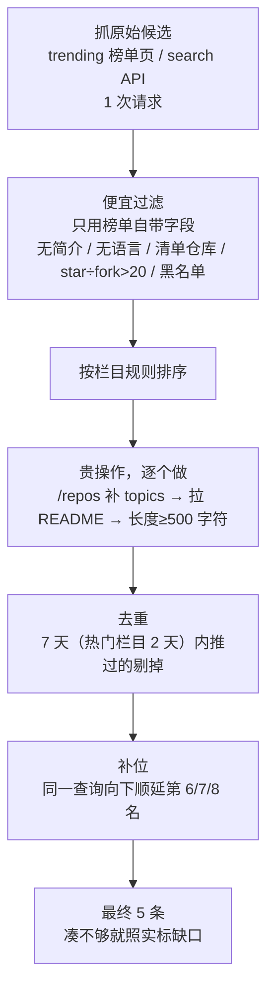

# GitHub 每日开源速递

每天早上把 GitHub 上的热门与新兴开源项目，用通俗中文总结（是什么 / 有什么用 / 多少成本），按栏目推送到企业微信内部群。

> 当前进度：**M0 已通过（云端 5/5）→ M1 采集层已通过（云端 5 个栏目各 5 条）**，下一步 M2 摘要层。后续按《项目策划书 v1.1》第 8 节逐项推进。

## 整体架构（做到哪一步了）



| 里程碑 | 内容 | 状态 |
| --- | --- | --- |
| M0 | 云端连通性 + 两项故障注入 | ✅ 2026-11-01 通过（5/5） |
| M1 | 采集层：5 栏目抓取、质量过滤、去重补位、配置校验、单测 | ✅ 2026-11-01 通过（云端 5/5 栏目达标） |
| M2 | 摘要层（DeepSeek） | 未开始 |
| M3 | 渲染与切分 | 未开始 |
| M4 | 状态与幂等 | 未开始 |
| M5 | 定时投递与企业微信 | 未开始 |

---

## M1 采集层

### 它做什么

每个栏目走同一条流水线，顺序刻意设计成「先便宜后昂贵」，避免刷爆 GitHub 每小时 1000 次配额：



每一步丢掉的候选都按规则计数，日志里能直接看到「今天被什么规则扔了多少条」：

```text
[freebies] 羊毛专区
  60 条原始 → 过滤后 10 条 → 去重 0 条 → 最终 5 条（缺口 0，补位 0，17.7s）
  丢弃：没有主语言 13 条 / 窗口期内没有活跃（pushed_at 太旧） 7 条 /
        清单仓库（名字命中 awesome/-list/cheatsheet 等） 2 条 / star/fork 比过高，疑似 star 通胀 2 条
```

### 五个栏目

| 栏目 | 数据源 | 排序依据 | 设计意图 |
| --- | --- | --- | --- |
| 今日热门 `trending` | `github.com/trending?since=daily` | 榜单原始顺序 | 今天全网在看什么 |
| 新兴潜力 `rising` | Search `created:>{14d} stars:>200` | star 数 | 刚冒出来但已经跑起来的新项目 |
| dsh 生态 `dsh-ecosystem` | Search `topic:dsh-plugin` | 最近更新 | 按 star 排会被头部吃掉，改成看最近活跃 |
| 开源工作台 `workbench` | Search `agent workbench in:name,description` | star 数 + 30 天活跃窗口 | AI 工作台方向 |
| 羊毛专区 `freebies` | Search `"free tier" in:name,description` | 最近更新 + 30 天窗口 | 免费额度 / 白嫖资源，必带合规黑名单 |

栏目全部写在 `config/columns.yaml` 里，**加栏目不改代码**；`enabled: false` 的栏目（示例 `finance`）在启动时就被完全跳过。

### 跑一次

```bash
# 只校验配置（拼错字段、缺字段、取值越界都会在这里被拦下）
python scripts/collect.py --check-config

# 本地 dry-run 全部栏目（需要 GITHUB_TOKEN，否则 60 次/小时的匿名配额不够）
GITHUB_TOKEN=$(gh auth token) python scripts/collect.py --out build/candidates.json

# 只跑两个栏目
python scripts/collect.py --columns trending,rising

# 云端（Actions → “M1 采集层” → Run workflow）
gh workflow run m1-collect.yml --ref main
```

退出码：`0` 全部达标 · `2` 配置错误 · `3` 有栏目采集失败 · `4` 有栏目不足 `--require-min` 条。

### 输出

`build/candidates.json`（schema_version 1）里每个栏目带完整统计与候选：

```json
{
  "schema_version": 1,
  "date": "2026-11-01",
  "duration_s": 132.2,
  "github": { "authenticated": true, "api_calls": 124, "run_id": "", "repository": "" },
  "columns": [
    {
      "id": "trending", "name": "今日热门", "source": "github_trending",
      "target": 5,
      "stats": { "raw": 17, "qualified": 10, "kept": 5, "deduped": 0, "shortfall": 0,
                 "dropped": { "no_description": 1, "awesome_name": 1, "no_language": 1 } },
      "items": [ { "full_name": "thedotmack/claude-mem", "stars": 108600, "stars_today": 1527 } ]
    }
  ]
}
```

同一次运行还会往 Step Summary 写一张「栏目 × 统计 × 每条候选」的表格，日志上传成 artifact。

### 单测

```bash
python -m unittest discover -s tests -t tests -v
```

67 个用例，覆盖 M1 验收要求的四类：

| 测试文件 | 覆盖 | 用例数 |
| --- | --- | --- |
| `tests/test_filters.py` | 6 条质量过滤规则 + 规则可关闭 | 18 |
| `tests/test_state.py` | 去重窗口边界（6 天算 / 7 天不算）、补位、缺口不拿历史凑数 | 15 |
| `tests/test_renderer.py` | 4000 字节切分、卡片边界不劈开、单卡超限独立成块 | 8 |
| `tests/test_config.py` | 拼错字段/缺字段/取值越界/重复 id/栏目语义冲突，全部要求中文可读报错 | 17 |
| `tests/test_collectors.py` | trending 正则钉死（页面改版必须炸，不许静默空栏目）、搜索日期占位符 | 9 |

### 本地实测（2026-11-01，本机出口）

| 栏目 | 原始 → 过滤后 → 最终 | 耗时 |
| --- | --- | --- |
| 今日热门 | 17 → 10 → 5 | 54.2s |
| 新兴潜力 | 40 → 10 → 5 | 16.3s |
| dsh 生态 | 40 → 10 → 5 | 18.2s |
| 开源工作台 | 40 → 10 → 5 | 25.9s |
| 羊毛专区 | 60 → 10 → 5 | 17.7s |

合计 124 次 GitHub API 调用、132 秒。**本机结果不代表云端**（runner 在美国机房，实测快 4 倍：云端 34.2 秒 / 129 次调用）。

### M1 云端验收（2026-11-01）

run [41313505927](https://github.com/palmer67/github-daily-digest/actions/runs/41313505927)：单元测试 job 7 秒（`Ran 67 tests … OK`），采集 job 43 秒，两个 job 全绿，`COLLECT_EXIT: 0`。

| 验收项（策划书第 8 节） | 实测 |
| --- | --- |
| 5 个栏目各输出 ≥5 条候选（JSON） | 5 个栏目全部 `最终 5 条`，`build/candidates.json` 27,934 字节，已上传 artifact |
| 配置缺字段/拼写错误启动时立刻报错 | 单测 17 条覆盖（拼错字段、缺字段、越界、重复 id、栏目语义冲突），报错为中文并指出正确写法 |
| 质量过滤生效（清单仓库 / 无简介 / star÷fork>20） | 日志逐栏目列出丢弃原因与计数，例如热门栏 `没有简介 1 / 清单仓库 1 / 没有主语言 1` |
| 核心逻辑单测（过滤 / 补位 / 切分各 ≥3 case） | 67 个用例：过滤 18、去重补位 15、切分 8、配置 17、解析 9 |

云端这次抓到的 25 条候选（节选）：

| 栏目 | 第 1 名 | 备注 |
| --- | --- | --- |
| 今日热门 | `thedotmack/claude-mem` ⭐108.6k（今日 +1527） | 榜单 17 条里过滤掉 3 条 |
| 新兴潜力 | `pengchujin/aerial-tv` ⭐8.6k | 40 条里 5 条因 star÷fork>20 被丢 |
| dsh 生态 | `Voyager77Twt/dsh-folder-search` ⭐4 | 按最近更新排，新插件 star 都还是个位数 |
| 开源工作台 | `ComposioHQ/composio` ⭐30.9k | 8 条因 30 天窗口不活跃被丢 |
| 羊毛专区 | `Defiabell/shotsync` ⭐212 | 60 条里 13 条无主语言被丢 |

---

## M0 验收记录（2026-11-01，云端）

首跑即通过：run [41312459131](https://github.com/palmer67/github-daily-digest/actions/runs/41312459131)，runner `ubuntu-26.04`（Azure westus2）。

| 检查 | 实测结果 |
| --- | --- |
| GitHub API | HTTP 200，core 配额 5000/5000，`GITHUB_TOKEN` 已认证 |
| DeepSeek API | HTTP 200，717 ms；prompt 25 / completion 1 / total 26 tokens；`thinking=disabled` 被接受 |
| 企业微信 webhook | HTTP 200，body `{"errcode":0,"errmsg":"ok"}`，**errcode == 0 → 判定成功** |
| 故障注入 A：错误 webhook key | **HTTP 200 + `errcode 93000`**（只看状态码会误判成功） |
| 故障注入 B：错误 DeepSeek key | **HTTP 401 `authentication_error`**（401 必须短路，不能重试） |

日志锚点：`M0 RESULT: PASS (5/5)`。企业微信群已实收测试消息；日志与摘要里 webhook key、DeepSeek key 均被掩码。

## 密钥纪律

- 三个密钥只存在于 **GitHub Secrets** 和运行时的环境变量里，从不落进仓库文件。
- M0 探针日志对 webhook key、DeepSeek key 一律掩码（`key=***`）；仓库里没有任何 `.env` 或密钥字符串。
- `.gitignore` 只是兜底，不承担安全职责。

## 目录

```
.github/workflows/m0-connectivity.yml   M0 云端冒烟（仅手动触发）
.github/workflows/m1-collect.yml        M1 单测 + 采集 dry-run（仅手动触发）
config/columns.yaml                     栏目与全局配置（改这里就能加栏目）
src/digest/                             M1 采集层
  config.py        YAML + pydantic 校验，错误翻成中文
  collectors/      trending 页面解析 / search API 采集
  filters.py       6 条质量过滤规则（纯函数）
  readme.py        README raw 优先、API 兜底
  state.py         去重窗口 + 补位（纯函数）
  renderer.py      按卡片边界切分（M3 会用）
  pipeline.py      单栏目流水线
  cli.py           命令行 + JSON 输出 + 退出码
scripts/collect.py                      采集入口
scripts/step_summary.py                 生成 Step Summary 表格
scripts/m0_probe.py                     M0 五项检查
tests/                                  67 个单测
probe/                                  本机实测用的原始探针（参考实现，不参与 Actions）
审核报告.md                             策划书 v1.1 的实测审核报告
```

## 已知限制（M1 阶段）

- 只采集与过滤，**不调 LLM、不渲染、不推送、不写状态**（`state/sent.json` M4 才落盘，M1 只读）。
- Actions 里只用手动触发，定时任务留到 M5，避免没接 LLM 就每天往群里推半成品。
- trending 靠 HTML 正则解析，是本期最大单点风险：解析到 0 条会直接抛错让 job 失败，不会静默推空栏目。
- 企业微信外部群不支持群机器人，必须用**企业内部群**的机器人。
