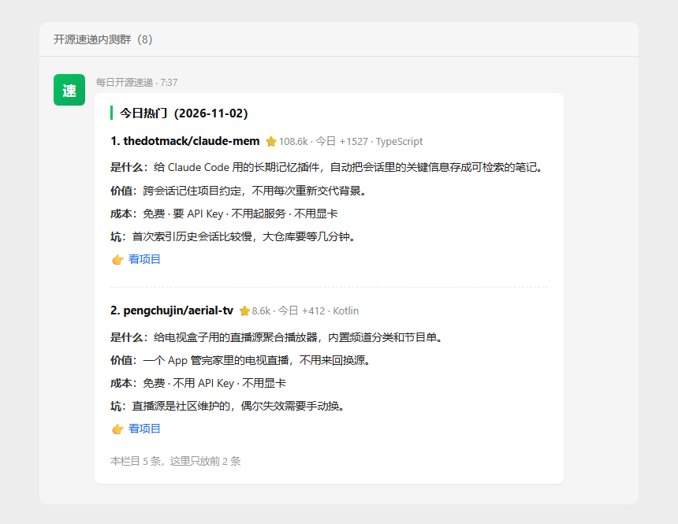
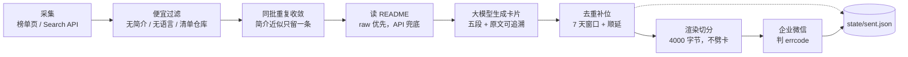

<p align="center">
  
</p>

<h1 align="center">GitHub 每日开源速递</h1>

<p align="center">
  <b>每天早上 7:30，把 25 个值得看的开源项目讲成人话，推到企业微信群。</b><br>
  <sub>不用翻 trending，也不用自己写介绍。</sub>
</p>

<p align="center">
  <a href="https://github.com/palmer67/github-daily-digest/actions/workflows/ci.yml"></a>
  
  <a href="LICENSE"></a>
  
  
</p>

---

## ✨ 它做了什么

每个项目一张卡片，四句话讲清楚：**是什么、有什么用、一个月花多少钱、有什么坑**。一条消息一个栏目，5 条一组。

| 栏目 | 收什么 | 怎么收 |
| --- | --- | --- |
| 今日热门 | GitHub 当天涨得最快的 | 解析 trending 页面 |
| 新兴潜力 | 半个月内新建、star 已经过 200 的 | Search API |
| dsh 生态 | 某个 topic 下的插件与工具 | 按 topic 收 |
| 开源工作台 | agent / workbench 类工具 | Search API |
| 羊毛专区 | 有免费额度的 API 与服务 | Search API，近 30 天活跃 |

<details>
<summary><b>几个真正花了功夫的地方</b></summary>

<br>

- **先便宜后贵**：只用榜单自带字段就能筛掉没简介、没主语言、清单仓库、star 与 fork 比例异常的；再把同批刷量仓库（简介一字不差）收敛成一条；最后才读 README、调模型。省下来的既是时间也是钱。
- **不让模型自由发挥**：卡片固定五段，每个成本字段必须能指回 README 原文，指不回来就写「未说明」；难度按 README 里的技术信号兜底，只上调不下调；README 只当资料，里面的指令不执行。
- **按卡片边界切消息**：企业微信 markdown 上限 4096 字节，按 4000 字节切、只在卡片边界切，不会把一张卡劈成两半。
- **去重与补位**：状态文件记最近一周推过谁；不足 5 条就顺着同一查询往下补；补不齐就在消息里写明「今日仅 N 条」，不拿历史凑数。
- **失败看得见**：推送结果不看 HTTP 状态码，只看企业微信返回的 `errcode`（HTTP 200 也可能是失败）；key 失效时整批降级成原始简介并单独发告警，任务标红；推送失败不写心跳。
- **没跑成也会喊人**：每天 08:10 还有一道守望——今天要是没有推送记录（典型原因：定时任务压根没触发），直接在群里发告警并把任务标红。定时任务最难受的失败不是「跑失败」，而是「安静得像没问题」。
- **零服务器**：全部跑在 GitHub Actions 免费额度上，一个月两三块钱。

</details>

## 🚀 快速开始

1. **Fork 本仓库**。
2. **准备两样东西**：企业微信内部群的机器人 Webhook（群设置 → 群机器人 → 添加）、DeepSeek 的 API Key。
3. **配 Secrets**（Settings → Secrets and variables → Actions）：

   | Name | 必填 | 说明 |
   | --- | --- | --- |
   | `DEEPSEEK_API_KEY` | ✅ | 生成摘要用 |
   | `WECOM_WEBHOOK_URL` | ✅ | 企业微信群机器人地址 |
   | `HEARTBEAT_URL` | ⬜ | 可选，外部心跳（如 healthchecks.io），企微整体挂掉时能收到邮件 |

   `GITHUB_TOKEN` 由 Actions 自动注入，不用建。

4. **手动跑一次或补跑**：Actions → `每日速递 · 定时投递与监控` → Run workflow，模式选 `happy`，栏目留空、强制重发选 `no`。已成功推送的栏目会自动跳过，只补其余栏目。
5. **等它自己跑**：默认每天北京时间 07:37 触发，另有 08:22 的备用入口（主跑成功时秒退，不重复推送）。cron 一律按 UTC 写（北京 07:37 = 前一天 23:37 UTC）；08:10 还有一道守望，今天没完成全部栏目会在群里告警。M4 是手动验收流程，默认只跑羊毛区，不用于日常补跑。

<details>
<summary><b>本地试跑（不发群、不花钱）</b></summary>

<br>

```bash
python -m pip install -r requirements.txt
export GITHUB_TOKEN=$(gh auth token)      # Windows: set GITHUB_TOKEN=...

python scripts/collect.py                            # 只采集，产出 build/candidates-<date>.json
python scripts/summarize.py --offline --limit 5      # 用离线桩跑通管道，不调模型
python scripts/push.py --cards build/cards-<date>.json   # 只渲染，不发送
python scripts/daily.py --dry-run                    # 全流程走一遍，不推送、不写状态
```

</details>

## 🧩 工作流程



一次运行一分钟左右：采集（几十次 GitHub 请求）→ 过滤 → 摘要（几十次模型调用）→ 推送。每张卡片都从 README 原文里取证，事后能核对。

## ⚙️ 配置

全部在 [`config/columns.yaml`](config/columns.yaml)，改完提交即可，不用碰代码。字段拼错、缺字段、重复 id 会在启动时就报中文错误，不会静默用默认值。

<details>
<summary><b>全局字段</b></summary>

<br>

| 字段 | 作用 |
| --- | --- |
| `global.items_per_column` | 每个栏目推几条（默认 5） |
| `global.dedupe_days` | 去重窗口，默认 7 天；榜单栏目可单独收紧 |
| `global.backfill` | 不足时是否顺延补位 |
| `global.max_message_bytes` | 单条消息字节上限，默认 4000 |
| `global.llm` | 模型、温度、超时、重试退避 |
| `filters.*` | 质量过滤与重复判定阈值 |
| `columns[].enabled` | 关掉的栏目连查询都不会发 |

</details>

加一个栏目：

```yaml
  - id: rust
    name: Rust 新项目
    enabled: true
    source: github_search
    query: "language:rust stars:>100 created:>{30d}"
    sort: stars
    pool: 40
    max_items: 5
```

`{30d}` 会替换成 30 天前的日期，所以查询不用每天手改。

## 💰 成本

| 项目 | 每天 | 每月 |
| --- | --- | --- |
| 模型调用（约 25 张卡） | 约 0.06 元 | 约 2 元 |
| GitHub Actions | 0（公开仓库免费） | 0 |
| 服务器 | 无 | 无 |

想更省：把 `items_per_column` 调到 3，或者关掉不关心的栏目。

## 🗂 项目结构

```
config/columns.yaml        栏目与全局配置
src/digest/
  collectors/              榜单页解析、Search API 采集
  filters.py               质量过滤 + 同批重复判定（纯函数）
  readme.py                README 获取与裁剪
  summarizer/              提示词、JSON 校验、难度兜底、客户端
  renderer.py              卡片渲染与按边界切分
  notifiers/wecom.py       企业微信推送与 errcode 判定
  daily.py                 每日编排：幂等 → 采集 → 摘要 → 推送 → 写状态
state/                     去重记录、运行记录、心跳（程序自动提交）
scripts/                   collect / summarize / push / daily / watchdog 等入口
.github/workflows/         定时投递、漏跑守望、CI（单测）、各阶段验收
tests/                     单元测试
```

## ⚠️ 已知限制

- 卡片质量靠「白名单 + 难度兜底 + 降级卡」，没有人工复核环节。
- README 只读开头 3000 字 + 安装段 3000 字，超长 README 的中段（常见 changelog）不参与判断。
- trending 靠 HTML 正则解析，页面改版会解析到 0 条并直接报错，不会静默推空栏目。
- 企业微信**外部群不支持**群机器人，必须是企业内部群。
- 「同批重复」只比简介文本，能抓一字不差的刷量仓库；语义聚类（同一天冒出来的几个同义项目）没做。
- dsh 生态栏目按最近更新排序，会收到 star 很少的新插件——这是有意的取舍：按 star 排会被头部项目长期占位。
- 触发时间由 GitHub 调度器排，偶尔会晚几分钟到半小时；cron 写的是 UTC，改时间时记得换算。
- 守望只检查「今天推没推」，不做内容质量判断。

## 🗺 Roadmap

- [x] 采集 / 摘要 / 推送 / 去重 / 定时 / 监控全链路
- [x] 推送失败与 key 失效的降级和告警
- [x] 漏跑守望（每天 08:10 检查，没推就告警）
- [ ] 语义级去重（embedding 聚类）
- [ ] 卡片配图（仓库截图或 og:image）
- [ ] 多渠道路由（飞书、邮件、Telegram）

## 📄 License

[MIT](LICENSE)
